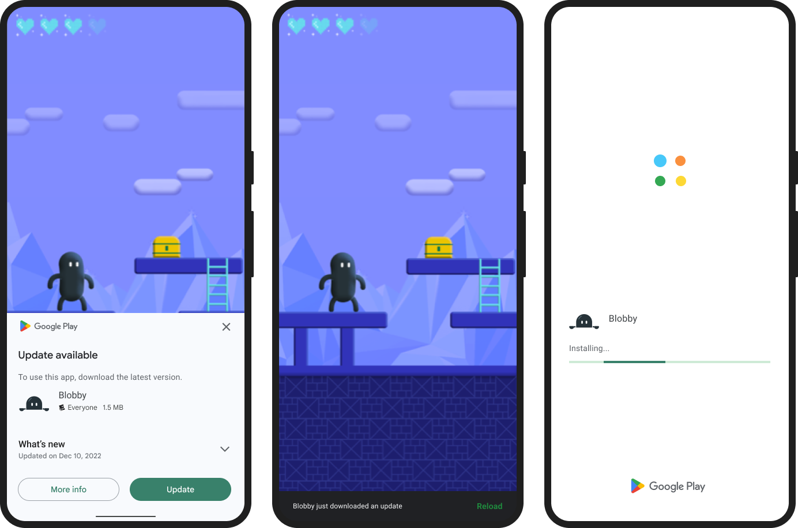
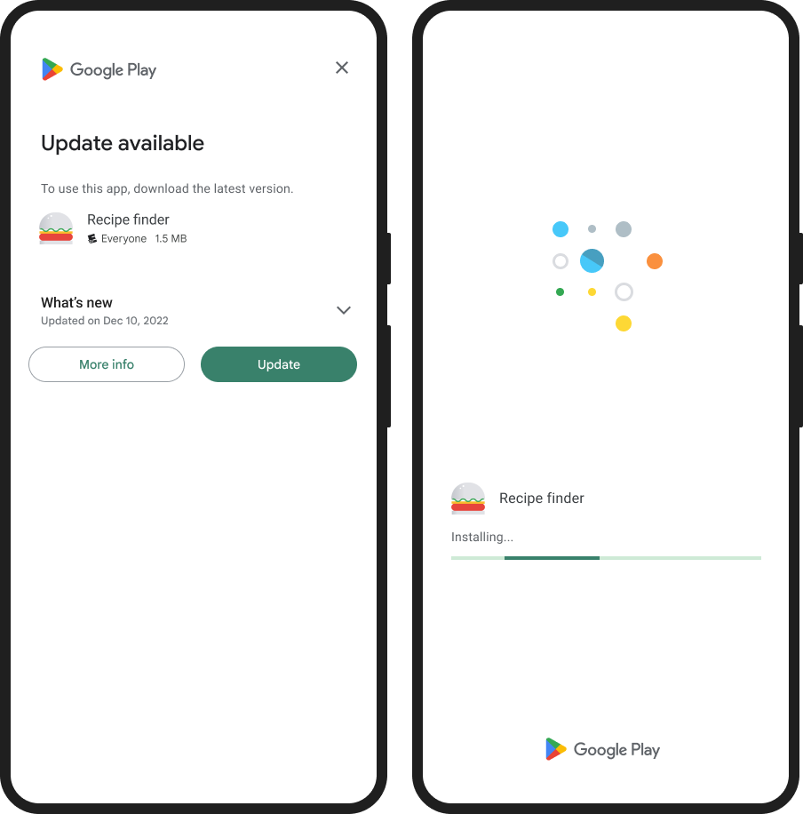
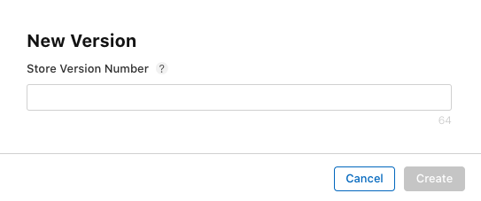

# Flutter Upgrade Version Package

A Flutter plugin for Android, iOS allowing get information about package, version info.

|                | Android | iOS |
|:----------------| :-----: | :-----:|
| **Support**   | ✅ | ✅ | 


## Features

* Get Package Information (app name, package name, version, build number).
* Get Information of Version at store (Apple Store).
* Support In App Update - Android

## Installation

First, add `flutter_upgrade_version` as a [dependency in your pubspec.yaml file](https://flutter.dev/using-packages/).

```dart
dependencies
  flutter_upgrade_version: ^2.0.0
```

## In-app Updates

The in-app updates feature is supported on devices running Android 5.0 (API level 21) or higher. Additionally, in-app updates are only supported for Android mobile devices, Android tablets, and ChromeOS devices.

[How to test In-App Update](https://medium.com/@tranglequynh710/how-to-test-in-app-update-in-android-be48562d445d)

Your app can use the Google Play Core libraries to support the following UX flows for in-app updates:

### Flexible Update Flows

Flexible updates provide background download and installation with graceful state monitoring. This UX flow is appropriate when it's acceptable for the user to use the app while downloading the update. For example, you might want to encourage users to try a new feature that's not critical to the core functionality of your app.




### Immediate Update Flows

Immediate updates are fullscreen UX flows that require the user to update and restart the app in order to continue using it. This UX flow is best for cases where an update is critical to the core functionality of your app. After a user accepts an immediate update, Google Play handles the update installation and app restart.




## Usage

### Package Information
You can use `PackageManager` to get information about the package.

```dart
import 'package:flutter_upgrade_version/flutter_upgrade_version.dart';

Future<void> getPackageData() async {
  PackageInfo _packageInfo = await PackageManager.getPackageInfo();
}
```

> `PackageInfo` class - Fields:
> - `appName` : the app name
> - `packageName` : the package name
> - `version` : the package version
> - `buildNumber` : the build number
> - `languageCode` : the language code of Locale.
> - `regionCode` : the country/region code for this locale. ISO 3166 alpha-2 country code

### `Android`: Using **In-app Update**

> **Note**: Be mindful of how often you request updates to avoid annoying or tiring your users. You should only request in-app updates for changes that are important to the core functionality of your app.

> 
```dart
/// Android
if (Platform.isAndroid) {
  InAppUpdateManager manager = InAppUpdateManager();
  AppUpdateInfo? appUpdateInfo = await manager.checkForUpdate();
  if (appUpdateInfo == null) return; //Exception
  try {
    if (appUpdateInfo.updateAvailability == UpdateAvailability.developerTriggeredUpdateInProgress) {
      ///If an in-app update is already running, resume the update.
      await manager.startAnUpdate(type: AppUpdateType.immediate);
    } else if (appUpdateInfo.updateAvailability == UpdateAvailability.updateAvailable) {
      ///Update available
      if (appUpdateInfo.immediateAllowed) {
        debugPrint('Start an immediate update');
        await manager.startAnUpdate(type: AppUpdateType.immediate);
      } else if (appUpdateInfo.flexibleAllowed) {
        debugPrint('Start an flexible update');
        await manager.startAnUpdate(type: AppUpdateType.flexible);
      } else {
        debugPrint('Update available. Immediate & Flexible Update Flow not allow');
      }
    }
  } on InAppUpdateException catch (e) {
    debugPrint('In-app update failed: ${e.code} - ${e.message}');
  }
}
```

### `iOS`: Information of Version on the Apple Store
We get the app information on Apple Store throught the `package_name` and `regionCode`. 

- You need to make sure the ID already exits on the Store.

- `RegionCode` where your app will be available to purchase or download. If  your app is not available across countries or regions, you can't lookup the app information on iTunes Search API. <br/>AppStoreConnect: **My Apps** > **AppName** > **Pricing and Availability** > **App Availability**

<br/>

> **Recommnend to ensure the `getiOSStoreVersion` function works**: The version number is shown on the App Store and should match the one you used in Xcode.

| Parameter | Description | 
| :-----: | :----- |
| `packageInfo` | **Required.** <br/>`PackageManager.getPackageInfo`|
| `regionCode` | **Optional**. The default is **US** <br/>The two-letter country code for the store you want to search. The search uses the default store front for the specified country. <br/>*See [ISO_3166-1_alpha-2](https://en.wikipedia.org/wiki/ISO_3166-1_alpha-2) for a list of ISO Country Codes.* 
```dart
///iOS
if (Platform.isIOS) {
  VersionInfo? _versionInfo2 = await UpgradeVersion.getiOSStoreVersion(
    packageInfo: _packageInfo, 
    regionCode: 'VN',
  );
  ///Example: VN - Viet Nam
}

```

With <span style='color:blue'>VersionInfo</span> class, I have provided information about:

* **canUpdate**: Return **true** if app can update.

* **isReviewing**: Return **true** if app is reviewing.

* **localVersion**: The current version of app.

* **storeVersion**: The current version of app on the store.

* **releaseDate**: The release date of current version on the store.

* **appStoreLink**: Link connect to App Store.

* **releaseNotes**: The notes of version on the store.


### In-app Update result

`startAnUpdate()` completes normally when the user accepts the update.

Otherwise it throws an `InAppUpdateException`, including when the user cancels. It contains:

- `code`: an `InAppUpdateErrorCode` describing why the update did not proceed. Use it to decide what to do and what to show.
- `message`: a human-readable description.
- `details`: additional platform information, if any.

| `code` (`InAppUpdateErrorCode`) | Description |
|----------------|----------------|
| `userCanceled` | The user has denied or canceled the update. |
| `updateFailed` | Some other error prevented either the user from providing consent or the update from proceeding.|
| `updateTypeNotSupported` | The requested `AppUpdateType` is not supported. |
| `checkForUpdateRequired` | `checkForUpdate` must be called before `startAnUpdate`. |
| `installFailed` | The update failed while downloading or installing. `details` holds the Play Core `InstallErrorCode`. |
| `unknown` | An error not covered by the values above. |

#### Showing errors to users (localization)

`message` is always in English and is not meant to be shown to users. To display an error in the user's language, map `code` to your own localized text:

```dart
String mapErrorToLocalizedMessage(BuildContext context, InAppUpdateErrorCode code) {
  final l10n = AppLocalizations.of(context)!; // your app's localizations
  return switch (code) {
    InAppUpdateErrorCode.userCanceled => l10n.updateCanceled,
    InAppUpdateErrorCode.updateFailed => l10n.updateFailed,
    InAppUpdateErrorCode.updateTypeNotSupported => l10n.updateNotSupported,
    InAppUpdateErrorCode.checkForUpdateRequired => l10n.updateFailed,
    InAppUpdateErrorCode.installFailed => l10n.updateInstallFailed,
    InAppUpdateErrorCode.unknown => l10n.updateFailed,
  };
}

try {
  await manager.startAnUpdate(type: AppUpdateType.flexible);
} on InAppUpdateException catch (e) {
  debugPrint('In-app update failed: ${e.code} - ${e.message}'); // log in English
  ScaffoldMessenger.of(context).showSnackBar(
    SnackBar(content: Text(mapErrorToLocalizedMessage(context, e.code))),
  );
}
```

#### Version comparison: < 2.0.0 vs >= 2.0.0

In versions before `2.0.0`, `startAnUpdate()` returns `Future<String?>`: `null` when the update succeeds, otherwise one of the messages below. No exception is thrown.

```dart
String? message = await manager.startAnUpdate(type: AppUpdateType.immediate);
if (message != null) {
  debugPrint('In-app update failed: $message');
}
```

| Message (< 2.0.0) | `InAppUpdateErrorCode` (>= 2.0.0) | Description |
|----------------|----------------|----------------|
| **MSG_USER_HAS_DENIED_OR_CANCELED_THE_UPDATE** | `userCanceled` | The user has denied or canceled the update. |
| **MSG_RESULT_IN_APP_UPDATE_FAILED** | `updateFailed` | Some other error prevented either the user from providing consent or the update from proceeding. |
| **MSG_APP_UPDATE_TYPE_NO_SUPPORT** | `updateTypeNotSupported` | AppUpdateType not support |
| **MSG_REQUIRE_CHECK_FOR_UPDATE** | `checkForUpdateRequired` | Required call `checkForUpdate` before `startAnUpdate` |
| **MSG_UPDATE_LISTENER_ERROR** | `installFailed` | The update failed while downloading or installing. |

To migrate to `2.0.0`, replace the `null` check with a `try`/`catch` on `InAppUpdateException`, and compare `e.code` instead of the message string.
